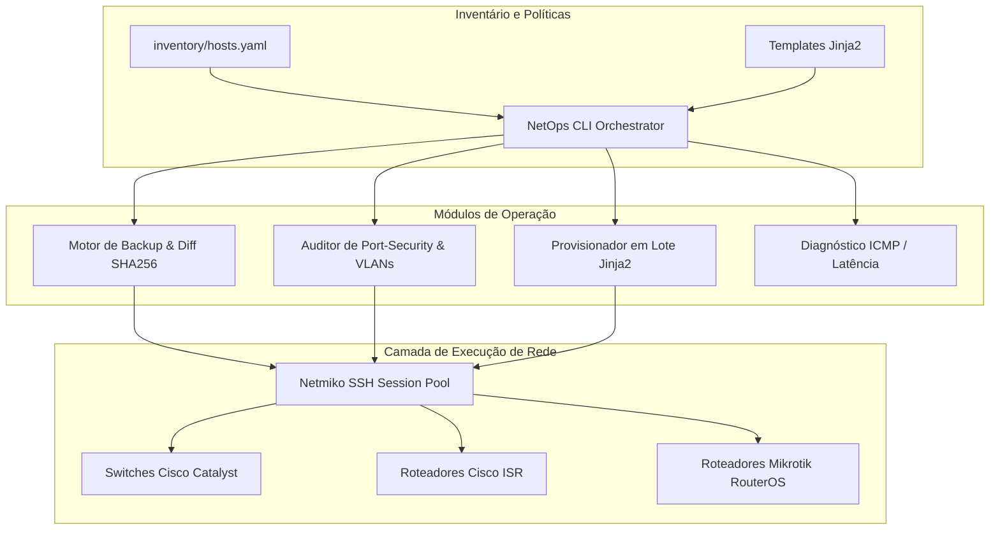

# 🌐 NetOps-AutoPilot // Framework de Automação de Redes Multi-Vendor

[](https://python.org)
[](https://github.com/ktbyers/netmiko)
[](https://cisco.com)
[](LICENSE)

> **Framework profissional de automação e orquestração de infraestrutura de redes para switches e roteadores Cisco IOS, Mikrotik RouterOS e Juniper JunOS.**  
> *Executa backups automatizados de running-config com validação criptográfica SHA256 e detecção de diff, auditoria de conformidade de portas (Port-Security/BPDU Guard), provisionamento em massa com templates Jinja2 e diagnóstico de conectividade.*

---

## 📸 Demonstração do Terminal de Automação

```
┌────────────────────────────────────────────────────────────────────────────────────────┐
│ 🔄 NetOps-AutoPilot // Status dos Backups de Rede                                      │
├──────────────────────┬────────────────┬────────────┬──────────────────┬────────────────┤
│ Hostname             │ IP             │ Fabricante │ SHA256 (Hash)    │ Status         │
├──────────────────────┼────────────────┼────────────┼──────────────────┼────────────────┤
│ sw-core-cat3850      │ 192.168.10.1   │ Cisco      │ 4b2f1809a1c2...  │ SALVO ✔        │
│ sw-dist-cat2960      │ 192.168.10.2   │ Cisco      │ 9a8c1722fd01...  │ ALTERADO ⚠     │
│ rtr-edge-isr4331     │ 192.168.1.1    │ Cisco      │ d41d8cd98f00...  │ SALVO ✔        │
│ rtr-branch-mikrotik  │ 192.168.20.1   │ Mikrotik   │ 7c4a8d09ca12...  │ SALVO ✔        │
└──────────────────────┴────────────────┴────────────┴──────────────────┴────────────────┘
```

---

## 🏛️ Arquitetura de Automação



---

## ⚡ Principais Funcionalidades

1. **Backups Automatizados e Auditoria de Mudanças (Diff Engine):**
   - Extrai configurações ativas (`show running-config` / `/export`) de switches e roteadores.
   - Gera hash criptográfico **SHA256** para cada versão de backup.
   - Compara automaticamente a configuração coletada com a versão anterior e gera relatório de diferenças (`diff -u`).

2. **Auditoria de Hardening de Portas (Port-Security & Spanning-Tree):**
   - Inspeciona todas as interfaces dos switches procurando portas de acesso desprotegidas contra ataques de **MAC Flooding**.
   - Sinaliza ausência de **BPDU Guard** contra loops acidentais na camada de enlace (L2).
   - Detecta portas Trunk configuradas com a VLAN nativa padrão (VLAN 1), prevenindo ataques de **VLAN Hopping**.

3. **Provisionamento em Massa com Jinja2:**
   - Permite criar VLANs, configurar descrições e aplicar regras de segurança em 50 switches simultâneos através de um único comando parametrizado.

4. **Diagnóstico Multi-Vendor & Ping Sweep:**
   - Varre o inventário corporativo medindo tempos de resposta (RTT) e reportando perda de pacotes em tempo real.

5. **Modo Híbrido (Simulação / Produção):**
   - Inclui modo mock nativo para execução offline, testes de homologação e demonstrações sem necessidade de equipamentos físicos conectados.
   - Use a flag `--live` para conectar aos equipamentos reais via SSH com Netmiko.

---

## 📂 Estrutura de Diretórios

```text
netops-autopilot/
├── inventory/
│   └── hosts.yaml                    # Inventário de switches e roteadores
├── templates/
│   └── cisco_vlan_provision.j2       # Template Jinja2 para provisionamento
├── src/
│   ├── core/
│   │   └── connection.py             # Sessões Netmiko com modo de simulação
│   ├── backup/
│   │   └── config_backup.py          # Extração, hashing SHA256 e diff
│   ├── audit/
│   │   ├── port_security.py          # Auditor de portas e VLANs
│   │   └── health_check.py           # Varredura de latência e conectividade
│   └── provisioning/
│       └── batch_deploy.py           # Aplicação de configurações em lote
├── tests/
│   └── test_netops.py                # Suíte de testes com Pytest
├── requirements.txt                  # Dependências do projeto
├── main.py                           # Ponto de entrada CLI
└── README.md                         # Documentação completa
```

---

## 🚀 Guia de Início Rápido

### 1. Instalação
```bash
git clone https://github.com/MarcosAosf/netops-autopilot.git
cd netops-autopilot

python -m venv venv
# No Windows:
venv\Scripts\activate
# No Linux/macOS:
source venv/bin/activate

pip install -r requirements.txt
```

### 2. Executar Backup Automático do Inventário
```bash
python main.py backup
```

### 3. Executar Auditoria de Port-Security e VLANs
```bash
python main.py audit
```

### 4. Provisionar uma Nova VLAN em Lote
```bash
python main.py provision-vlan --vlan-id 30 --vlan-name SERVIDORES_DMZ --range "GigabitEthernet1/0/10 - 20"
```

### 5. Executar Diagnóstico de Latência dos Hosts
```bash
python main.py health
```

---

## 👤 Autor & Contato

**Marcos A.**  
*Analista de Suporte de Redes | Automação, Hardening & Cibersegurança*  
- **GitHub:** [@MarcosAosf](https://github.com/MarcosAosf)

---
*Distribuído sob a Licença MIT.*
